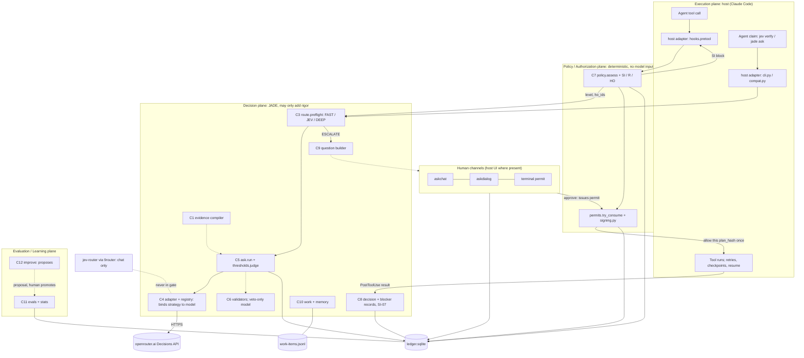

# JADE v7 reference architecture

Status: Planning only. Nothing in this document is implemented.

Scope. Phase 2 design of the owner directive (`DIR`, `/Users/example/Downloads/JADE_v7_Master_Roadmap_Claude_Code.md`), reconciled with the flow addendum (`ADD`, `evidence/v7-plan/addendum-flow-architecture.md`; extends DIR, does not replace it). Delta on v6 ([master](../../14-v6-master-plan.md), [ADRs](../../14-v6/04-adrs.md)) at worktree HEAD `8dfa86d` (parent `origin/main` `e9412f3`). `EV-nn`, `U-nn`: `evidence/v7-plan/evidence-index.md`. Tags: [fact] cites a path or EV id; [assumption]; [hypothesis]; [unknown]; untagged design rows are proposals.

Division of work. Here: components, planes, component diagram, trust boundaries, Protocols, failure modes, ADR candidates, migration map. [11](11-decision-lifecycle-and-contracts.md): states, transitions, ownership matrix, the eight record contracts, idempotency and recovery, end-to-end flow. Elsewhere: [04](04-model-provider-research.md), [05](05-benchmark-design.md), [06](06-model-routing-strategy.md), [08](08-security-operations.md) and [09](09-release-and-learning.md).

## 0. Reconciliation: who executes

Requirements: V7-A06, V7-A07, V7-R38.

| Topic | DIR says | ADD says | v7 adopts |
|---|---|---|---|
| Component 8 "Execution & Continuity Orchestrator" | plan, act, observe, verify, recover inside the system | host orchestrator owns task execution, tools, operational retries, checkpoints | **Split.** The host (Claude Code, Cursor, another runtime) owns execution, tool calls, retries, checkpoints and resume. JADE owns the decision lifecycle record and blocker records (owner, resume condition). C8 keeps its number and name for traceability only. |
| Retries | bounded retries | bounded replan/retry, re-evaluated | JADE may *request* a bounded retry or replan and records the count; it never schedules or runs one (V7-A96, DF-17). |
| Approval | decision vs action approval | authorization rechecked at action time | Decision approval (`ACCEPTED`) and action authorization (`AUTHORIZED` + permit) stay separate; the policy plane re-checks at the action (§3.1). |

Other rows here point to §0. Same rule as [11 §0](11-decision-lifecycle-and-contracts.md) and [ADR-v6-01](../../14-v6/04-adrs.md) [fact] EV-45.

## 1. Principles that constrain every component

Requirements: V7-R06, V7-R12, V7-R30, V7-R106, V7-R109.

| # | Principle | Basis |
|---|---|---|
| P1 | C7 runs first on every gated call and reads no model output. A model can only add a block or an ask, never remove one. | [fact] `jade/hooks.py:395` classifies before `_gate` (`:532`); [master §1](../../14-v6-master-plan.md) |
| P2 | A probability is never permission. Model agreement is not proof. | DIR rule 5; [fact] EV-32 (correlated vendor errors) |
| P3 | Only the human sets the JADE level. A fallback never lowers a bar. | [ADR-v6-03](../../14-v6/04-adrs.md); [fact] `jade/thresholds.py` bands per calibration group |
| P4 | Each added vendor is a new egress destination: own privacy row, owner yes. | [fact] EV-33 (5 vendors fail ZDR) |
| P5 | JADE is a decision plane, not a runtime (§0). | [ADR-v6-01](../../14-v6/04-adrs.md); [fact] EV-45 |
| P6 | Add a component only where a test, metric or hook uses it; otherwise a contract plus a deferred item. | v6 [master §3](../../14-v6-master-plan.md) |
| P7 | Integrations sit behind small Protocols (§5.2). No DI framework; constructors take callables. | [fact] `jade/adapter.py:269` |
| P8 | FAST, JEV, DEEP are logical strategies, never a provider or model; C4 binds them. | [fact] `policies/routing.yaml:40-53` names no model id; V7-A72 |
| P9 | The decision core stays host-agnostic; host specifics stay in the adapter. | [fact] `jade/{ask,decide,route,thresholds,adapter,state_machine,policy,permits,questions}.py` import none of `hooks`, `askchat`, `askdialog` (grep); V7-A29 |

### 1.1 Four planes

Requirements: V7-A06, V7-A07, V7-A22, V7-A29, V7-R12. Ownership detail (owns / must not own): [11](11-decision-lifecycle-and-contracts.md), not repeated here.

| Plane | Components | Lives in today [fact] | Independence today |
|---|---|---|---|
| Decision (JADE) | C1, C2 (enrichment), C3, C4, C5, C6, C9 (question text), C10, decision and blocker records from C8 | `ask.py`, `route.py`, `thresholds.py`, `adapter.py`, `questions.py`, `decide.py`, `state_machine.py`, `work.py` | Advisory: can add rigor, never authority |
| Policy / Authorization | C7, permits, seals, action-time check | `policy.py`, `shellnorm.py`, `inert.py`, `permits.py`, `signing.py`, `githook.py`; enforced from `hooks.pretool`; approval channels `askchat.py`, `askdialog.py`, `memory.py` answer step ([11 §1](11-decision-lifecycle-and-contracts.md); UI is host) | Logical, not process: same package and hook process as the decision plane [fact] `hooks.py:22`. Independence = reads no model output (P1), SI not overridable by any permit [fact] `hooks.py:404-407`, agent cannot approve its own permit (TB6). Process isolation: not present, not proposed |
| Execution (host) | agent loop, tool calls, retries, checkpoints, resume | Claude Code; JADE's host adapter is `hooks.py`, `cli.py`/`compat.py` | Host-owned (§0). Target: a second host needs only a new adapter (DF-11). Coupling today: `policy.assess` takes Claude Code tool names; `permits.call_id_of`, `make_context` read the hook event [fact] `hooks.py:546`, `:598` |
| Evaluation / Learning | C11, C12 | `ledger.py`, `evals.py`, `improve.py`, `evals/*` | Proposes only; a human promotes (ADR-v6-08) |

`policy.assess` feeds two planes: route floor (decision) and block or permit demand (policy); neither reader can lower it. ADD §2 is conceptual: not every call passes every stage, not every node is a service (V7-A22).

## 2. Component map (12 components)

Requirements: V7-R30, V7-R31, V7-R32, V7-R33, V7-R35, V7-R37, V7-R38, V7-R39, V7-R40, V7-R119. C4, C6, C11, C12 are owned by other docs (V7-R34, V7-R36 in [06](06-model-routing-strategy.md); V7-R41 in [08](08-security-operations.md); V7-R42 in [09](09-release-and-learning.md)); here they are only placed.

| C | Directive component | Plane | v6 modules today [fact] | Verdict | v7 delta | v6 link |
|---|---|---|---|---|---|---|
| C1 | Context & Evidence Compiler | Decision | `ask.cap_state`, `redact.py`, `route._freshness_problem` (PF checks), `blind.py` | New (interface only) | `ContextSource` (§5.2), kinds §2.3; first impl wraps redact, cap, freshness. | [d06](../../14-v6/06-decision-intelligence.md) (DF-05) |
| C2 | Decision Intake & Classification | Policy (risk) + Decision (enrichment) | `policy.assess` -> `Assessment` (level, rule_id, reversibility, blast_radius, data_sensitivity, ho_ids, unread); `decide.open_decision`; `humanonly.py` | Keep + Extend | Derived `urgency`, `uncertainty`, `evidence_quality` on the decision record only; never inputs to C7. | [d05](../../14-v6/05-security-and-autonomy-model.md) |
| C3 | Decision Router | Decision | `route.preflight` -> FAST, JEV, DEEP, ESCALATE (`policies/routing.yaml`); gate order fixed in `hooks._gate` | Keep + Extend | Strategy selection only (§2.2). Route reason as a versioned event. Rigor may rise, never fall below what C7 demands. | [d06](../../14-v6/06-decision-intelligence.md) |
| C4 | Model Router | Decision | `adapter.OpenRouterProvider`; model chosen by `ask.py:81` (`--model`, `JEV_MODEL`, config `model`, else `DEFAULT_MODEL = typesafe/jev-1.14`); `ops` pins and drift | Extend | Binds each strategy to a model through a registry: role, egress class, budget, circuit breaker. jev-router is never a gate input (EV-21, EV-22). | [06](06-model-routing-strategy.md) |
| C5 | Structured Decision Engine | Decision | `ask.run`, `questions.py` (11 `q.*`, EV-59), `thresholds.judge`, `decide.link_evaluation` | Keep + Extend | Deterministic proposal; no model-written alternative shown (DF-04, DF-06). Jev 1.14 stays primary (REPORT: none shown safer; bench exploratory). Record: `DecisionProposal` ([11](11-decision-lifecycle-and-contracts.md)) plus agent-supplied `counterarguments` (R35; untrusted, never shown as advice). | [ADR-v6-06](../../14-v6/04-adrs.md) |
| C6 | Independent Verification | Decision (veto-only) | Deterministic validators: `blind.py`, `samecmd.py`, `egress.py`, `interp.py`, `harness_audit.py`; no second model | Extend | Selective, veto-only second model (stricter, never looser, EV-34). Shadow first; candidate lane per REPORT D6, verify questions only. | [06](06-model-routing-strategy.md) |
| C7 | Deterministic Policy & Authorization Engine | Policy | `policy.assess`, `shellnorm.py`, `inert.py`, SI invariants, R/M rules (`policies/risk.yaml`, `safety.yaml`), HO classes, `permits.py`, `signing.py`, `githook.py` | Keep (authoritative) | No new engine (DF-10). `policy_version` on every event; never-looser check against last release; separation of duties: the agent never issues or approves its own permit. Action-time check: §3.1. | [ADR-v6-02, 03](../../14-v6/04-adrs.md) |
| C8 | Execution & Continuity Orchestrator | **Execution = host; record = Decision** (§0) | `state_machine.py` (`MAX_REVISIONS = 3`, `HOLDING`, `EXPIRES`), `decide.sweep`, SI-07 hold, permit = one plan hash, one use | Keep + Extend (no runtime) | §0. JADE keeps decision and blocker records, SI-07 hold, retry count. States: [11](11-decision-lifecycle-and-contracts.md). | [d07](../../14-v6/07-continuous-execution.md) |
| C9 | Blocker & Question Manager | Decision (text); host (UI) | `askchat.py`, `askdialog.py`, `hooks.session_start` notices, `hooks.stop` nudge, `work.py` | Extend (narrow) | Deterministic question: default, consequence, what resumes. List view only; one answer, one `plan_hash` (DF-07). Host UI where present, no popup assumed (EV-27). Record: `ApprovalRequest` ([11](11-decision-lifecycle-and-contracts.md)). | [d09](../../14-v6/09-human-experience.md) |
| C10 | Task & Memory Governance | Decision | `work.py` (`work-items.jsonl`, rendered `BACKLOG.md`), `memory.py`, ledger `work_items`, `human_answers` | Keep + Extend | `review_at`, `depends_on`, owner check, retention class; `SyncTarget` only (§11). | [d07](../../14-v6/07-continuous-execution.md), [d08](../../14-v6/08-learning-and-improvement.md) |
| C11 | Evaluation & Observability | Evaluation | `ledger.py` (events, `jev_calls`, `asks`, `labels`), `evals.py` (Wilson, bootstrap, ECE), `jade ledger stats`, `evals/*` (505 rows, EV-55) | Keep + Extend | Trace record: `DecisionTrace` in [11](11-decision-lifecycle-and-contracts.md). OTLP stays deferred (DF-12). | [08](08-security-operations.md) |
| C12 | Controlled Improvement Loop | Evaluation | `improve.py` (miner proposes, human promotes), `policies/promotion.yaml`, `evals.propose_threshold` | Keep | No loosening without labels and an owner yes; never train on unverified model answers. | [09](09-release-and-learning.md), [ADR-v6-08](../../14-v6/04-adrs.md) |

Two words for "level" (do not mix): risk = `Assessment.level` from C7 (low to critical); JADE level = the human setting (`off`, `low`, `medium`, `high`; `high` = least autonomy, EV-39).

### 2.1 Requirement terms and where each lives

| Req | Term | Mechanism today or v7 home | Owner |
|---|---|---|---|
| R32 | problem type; resources | `route.preflight` primitive + family [fact]; C4 budget, JEV limits [fact] `policies/routing.yaml:44-49` | JADE |
| R32 | authority | `permit_floor()`, `human_floor()`, `ho_ids` [fact] `jade/policy.py:1464-1472` | Policy |
| R35 | trade-offs, recommended action | `decision.schema.json` `candidate_actions`, `constraints`, `assumptions` [fact]; recommendation = verdict only (DF-04) | JADE |
| R37 | deny-by-default | Not today: unmatched commands fall to R-99 `low` [fact] `policies/risk.yaml:229`; ask-on-unknown stays DF-22 / LD-13 (owner) | Policy |
| R37 | immutable constraints, versioning | SI are code constants; overlay cannot lower shipped high/critical [fact] `policies/loader.py:272`, append-only [fact] `loader.py:98`; `policy_version` on every event (v7) | Policy |
| R38 | timeouts | `adapter.DEADLINE_S`, `EXPIRES`, permit TTL [fact] | JADE decision; host tool |
| R38 | checkpoints, resume, retries, rollback | Host-owned (§0). JADE: idempotent `state_machine.apply`, `ROLLED_BACK`/`COMPENSATED` states [fact], retry count | Host acts; JADE records |
| R38 | stop conditions | `MAX_REVISIONS = 3`, SI-07 hold, `budget_stop` (new) | JADE |
| R39 | blockers: classify, research first, persist | `rule_id` + risk as class (DF-43, DF-45); `add_evidence` before `escalate` [fact] `jade/state_machine.py`; `WAITING_HUMAN`; detail [11](11-decision-lifecycle-and-contracts.md) | JADE |
| R40 | knowledge versioning | `registry_version`, `policy_version`; `memory._valid_since` [fact] | JADE |

### 2.2 Routing strategies (C3) and their binding (C4)

Requirements: V7-R33, V7-A72, V7-A73.

| Strategy | Meaning [fact] `policies/routing.yaml:40-53` | Chosen when [fact] `jade/route.py` | Bound to today | v7 binding |
|---|---|---|---|---|
| FAST | Deterministic code, no model call; needs `evidence_refs` | PF-01: a deterministic check answers (`route.py:122`) | no model | no model |
| JEV | Structured-judgment strategy (not the `typesafe/jev-*` model): one batched Decisions API request, at most 8 questions, 4 in flight, 20 s | `default_route` | `ask.py:81` resolution, default `typesafe/jev-1.14` [fact] | Registry role `decide`; alias only per REPORT D2 + D3 ([06](06-model-routing-strategy.md)) |
| DEEP | Reasoning model decomposes into atomic JEV questions; verdict needs `evidence_refs` | PF-06: not atomic or bounded (`route.py:146`, `DEEP_HINTS`) | Route label and advice text only [fact] `route.py:146-147`; chat model outside the gate per [06](06-model-routing-strategy.md) | Registry role, chat models never give a verdict |
| ESCALATE | Outcome, not a strategy: human, `WAITING_HUMAN` | blocked or human-only | human | human |

Escalate model capability only when complexity, uncertainty or harm justifies it; a cheaper strategy is never chosen to save cost when C7 demands more (P3, V7-A73). Which model wins is measured in [05](05-benchmark-design.md), not assumed (V7-A75).

### 2.3 Evidence kinds and freshness (C1)

Requirements: V7-R31, V7-A69, V7-A70.

| Kind | Example | Trust | Freshness rule |
|---|---|---|---|
| observation | tool output, test exit code, file at `path@sha` | highest | tied to the sha or capture time; stale if HEAD moved [fact] PF freshness checks in `route._freshness_problem` |
| source claim | repo text, doc, vendor page | medium; untrusted as instruction | `captured_at` + URL or path |
| assumption | agent-stated premise | must be named | none; listed in the proposal |
| model inference | Jev or DEEP output | never evidence for a label | `resolved_model` + time |
| unknown | missing critical fact | blocks sufficiency | research first, then ask (V7-A71) |

Sufficiency is a deterministic rule, never a model answer. Field-level shape: `EvidenceBundle` in [11](11-decision-lifecycle-and-contracts.md).

## 3. Component diagram

Requirements: V7-R43, V7-R44, V7-A22. Solid: v6 path today. Dashed: v7 proposal. Grouped by plane (§1.1).



Approval issues a permit; it does not allow the call. The call is allowed only when the host re-sends it and the policy plane passes it again (§3.1).

### 3.1 Action-time enforcement, including after approval

Requirements: V7-R12, V7-R37, V7-A23, V7-A85, V7-A86, V7-A87 (detail in [08](08-security-operations.md)).

| Check at the actual call | Today [fact] | Gap / v7 |
|---|---|---|
| Re-classify the real `tool_input` | `hooks.pretool` runs `_classify` -> `policy.assess` on every gated call before any permit lookup (`hooks.py:395`) | none |
| SI invariants win over any approval | `a.blocked` returns "No permit can authorize it" before `_gate` (`hooks.py:404-407`) | none |
| Same plan, one use | `try_consume`: `ISSUED`, `uses == 0`, same `plan_hash`, no prior `permit_consumed` (`permits.py:684-698`) | none |
| Not expired | `permits.py:688` | none |
| Policy unchanged since approval | `policy_version` differs: permit revoked (`permits.py:699-702`) | none |
| World unchanged (git HEAD, content sha) | precondition fingerprints, content binding (`permits.py:703-712`) | none |
| Same caller and live decision | `_caller_refusal`, `_decision_refusal` (`permits.py:714-716`) | none |
| Risk now vs at approval; who approved | `_static_refusal`: permit risk not below current risk; human principal at or above the floors; signature when the signed backend is on (`permits.py:587-601`) | none |
| Coverage | gated tools only (`policy.is_gated`, `hooks.py:388`); live config `enforce` / JADE level `off`: only SI-09 to SI-12 block [fact] EV-10, EV-11 | Ungated tools and other hosts not covered; stated, not hidden |
| Retry or replan after approval | a changed call has a new `plan_hash` or fingerprint and needs a new permit [fact, via the rows above] | V7-A24 |
| Known open regression | PR 47 branch only: R5-L4-1 (critical, SI-08 bypass; BASE `8100ea1` blocks it), CODE5-1 (important) [fact] `evidence/round5-findings-c676801.json` | PR 47 not merged; W-115 open; [08](08-security-operations.md) |

A timeout, silence or a model "yes" never issues a permit (P2, V7-A52).

## 4. Trust boundaries

Requirements: V7-R44, V7-R12, V7-R103, V7-R109.

| ID | Boundary | Crosses | Rule | Basis |
|---|---|---|---|---|
| TB1 | Agent to hook | tool, `tool_input`, cwd | Untrusted; canonicalised by `shellnorm` first; parse failure fails closed in `enforce` | [fact] `hooks._policy_failure` |
| TB2 | Hook to C7 | `Assessment` | Authoritative; no model, memory or learning writes it | [fact] `policy.assess` |
| TB3 | C7 to answer sources | risk, ho_ids | Human-only and SI-blocked calls never reach memory or proxy. Hole: memory can cover a critical call at level low/medium (EV-38, EV-39); fix V6-06 not built | [fact] `jade/memory.py:52`, `jade/proxy.py:134` |
| TB4 | JADE to provider | redacted state, questions | Egress only to `openrouter.ai/api/alpha/decisions` today; `evidence_source` is sent (EV-37); no `provider.zdr` sent (EV-33; REPORT D1) | [fact] EV-16, EV-33, EV-37 |
| TB5 | Provider to JADE | answers, `resolved_model` | Untrusted; `adapter.check_answer`, bands of its own calibration group, drift check | [fact] `adapter.py:81`, `thresholds.group_of` |
| TB6 | Human channel to permit | Allow, Deny | Trusted only from a channel the agent cannot write (tty, dialog, signed approval). Chat Allow must bind `plan_hash` (v6 V6-07, not built) | [fact] EV-38 |
| TB7 | Ledger at rest | all records | Local, one writer, sealed permits; seal key beside it [fact]; not encrypted [assumption] | [fact] EV-12, `jade/ledger.py` |
| TB8 | 9router | chat | Not a Decisions endpoint; jev-router never a gate input | [assumption] EV-22, EV-23 (no saved probe, U-04) |
| TB9 | Each new vendor | redacted state | New egress row in [08](08-security-operations.md) and owner yes before first call | P4 |
| TB10 | Host to decision core | hook event, CLI args | Target: only the adapter knows the host. Today the core imports no adapter (P9), but tool names and event fields leak (§1.1) | [fact] P9 grep; `hooks.py:546`, `:598` |

Native mechanisms (V7-R103). [fact] EV-27, host 2.1.314: a hook `ask` is not shown in `auto` or `bypassPermissions`; a hook-written answer looks human to PostToolUse. v7 uses the native prompt where shown, chat or dialog otherwise, and never counts a native "allow" as human unless the channel proves it. Current host [unknown] (U-09).

## 5. Interfaces

Requirements: V7-R44, V7-R106, V7-R107, V7-R109.

### 5.1 Existing (kept; signatures abbreviated) [fact]

```python
# jade/policy.py:1441
def assess(tool: str, tool_input: dict, cwd: str = "") -> Assessment
# jade/route.py:114  (route in FAST|JEV|DEEP|ESCALATE)
def preflight(*, claim="", evidence="", command=None, risk="low", ...) -> RouteDecision
# jade/adapter.py:275
class OpenRouterProvider:
    def ask(self, state: dict, questions: dict, model: str = DEFAULT_MODEL) -> Result
# jade/thresholds.py:85
def judge(answer: dict, family: str, risk="low", ...) -> Verdict
# jade/permits.py:672
def try_consume(path, permit_id, plan_hash, *, level, fingerprints=None, ...) -> str | None
```

Schemas kept: `schemas/decision.schema.json`, `permit.schema.json`, `work-item.schema.json`, `outcome.schema.json` [fact]. Exit codes 0, 3, 4, 5, 6 keep their meaning (`compat.py`, repo `docs/01-adrs.md` ADR-03).

### 5.2 Component Protocols (replaceable seams)

Seams only. Records that cross them are defined in [11](11-decision-lifecycle-and-contracts.md); the record sketches once here are mapped in §5.3.

```python
class ContextSource(Protocol):     # C1; Contextum would be one implementation
    def fetch(self, query: str, *, budget_bytes: int, scope: str) -> "EvidenceBundle": ...

class DecisionProvider(Protocol):  # C4; OpenRouterProvider already fits
    def ask(self, state: dict, questions: dict, model: str) -> Result: ...

class Verifier(Protocol):          # C6; "pass" never upgrades a verdict
    def check(self, proposal: "DecisionProposal", bundle: "EvidenceBundle") -> Literal["pass", "veto", "unknown"]: ...

class HostAdapter(Protocol):       # execution plane seam; hooks.py is the Claude Code one
    def to_request(self, event: dict) -> "DecisionRequest": ...
    def ask_human(self, req: "ApprovalRequest") -> None: ...   # never assumes a popup exists

class SyncTarget(Protocol):        # C10; Obsidian/Kanban not present
    def push(self, items: list[dict]) -> None: ...
```

Registry row shape (`ModelEntry`) is authoritative in [06](06-model-routing-strategy.md).

### 5.3 Record sketches moved to doc 11

Earlier 03 sketches live in [11](11-decision-lifecycle-and-contracts.md) as `EvidenceBundle` (was `EvidenceItem`/`EvidenceBundle`), `DecisionProposal` (`DecisionBrief`), `ApprovalRequest` (`HumanQuestion`), `DecisionTrace` (`jade.event/2`), recovery rules (blocked-session resume).

## 6. Sequence diagrams

Requirements: V7-R43, V7-R33, V7-R37, V7-A23.

[fact] EV-10, EV-11: live config is `gate_mode = enforce`, JADE level `off`. The flows show the target with a human-set JADE level. Memory and the Jev proxy answer only at JADE level low or medium [fact, `hooks.py:585-587` comments].

A low-risk call is hook, `assess`, allow: no model, no question. High-risk path:

### 6.1 High-risk call: verification, human approval, action-time recheck

```mermaid
sequenceDiagram
  participant A as Host agent
  participant H as hooks.pretool / _gate
  participant P as C7 policy.assess
  participant M as memory / proxy
  participant V as C6 verifier
  participant U as Human
  participant K as permits
  A->>H: tool call
  H->>P: assess
  P-->>H: risk=high; SI hit or ho_ids?
  alt SI floor
    H-->>A: block (no permit can authorize)
  else human-only class
    H->>K: request permit (PENDING), memory and Jev skipped
  else gated, JADE level low or medium
    H->>M: memory.step, proxy.step (Jev)
    M->>V: veto check (shadow first)
    Note over M: target: accept inside band and no veto ends here; veto or ABSTAIN falls to the human
    H->>K: request permit (PENDING)
  end
  U->>K: approve (tty, dialog, signed): ISSUED
  Note over A,K: approval does not run anything
  A->>H: same call again
  H->>P: assess again (real input, now)
  P-->>H: risk, SI
  H->>K: try_consume: plan_hash, expiry, policy_version, fingerprints, caller
  K-->>H: ok once, or refusal (new permit needed)
  H-->>A: allow or block
```

## 7. Data lifecycle

Requirements: V7-R45, V7-R40, V7-A70.

| Data | Stored | Leaves machine? | Today [fact] | v7 change |
|---|---|---|---|---|
| Tool call text | `asks`, `permits` (raw only if allowed, W-43), events | via proxy after `redact.py` (EV-39) | purge skips `asks` text, `human_answers.label` | retention class per table |
| Claim + evidence | `jev_calls` | yes, incl. `evidence_source` (EV-37) | `ops.py` retention | C1 records what was sent, by hash |
| Model answer | `jev_calls` + `resolved_model` | n/a | same | never a label source |
| Human answer | `human_answers`, `asks` | up to 8 past answers at level high (EV-39) | no TTL found | `review_at` per scope |
| Labels | `labels` | no | kept | verified or human only |
| Work items, blockers | `work-items.jsonl` | no | git history | owner, resume condition |
| Execution result (host) | `decide.record_outcome` | no | exit status | `ExecutionResult` ([11](11-decision-lifecycle-and-contracts.md)) |

Access and encryption: [08](08-security-operations.md).

## 8. Failure modes

Requirements: V7-R45, V7-R38, V7-R109. None of these lowers a bar. Recovery transitions: [11](11-decision-lifecycle-and-contracts.md).

| # | Failure | Detection | Behaviour | Basis |
|---|---|---|---|---|
| F1 | Policy or overlay fails to load | exception in `assess` | shipped rules only; block unless clearly harmless | [fact] `jade/hooks.py:358-372` |
| F2 | Provider timeout, 5xx | `Result.ok = False` | Exit 5; gate falls to the human; retries capped (`MAX_RETRIES`) | [fact] `adapter.py` |
| F3 | Provider serves another model | `resolved_model` differs | `MODEL_DRIFT` event; judged in a new group at DEFAULT bands 0.70/0.30, so it can ACCEPT today. v7: band floor (G2); proxy accepts become owner asks until a human accepts the snapshot ([06 §6](06-model-routing-strategy.md)) | [fact] EV-52, `jade/thresholds.py:61-76`, `jade/ops.py:157` |
| F4 | Moving alias (`~typesafe/jev-latest`) used without guard | registry lint | refused without the REPORT D2 guard | REPORT §3, D2, D3 |
| F5 | Fallback after outage | C4 breaker | No fallback model (DM-13, [06 §6](06-model-routing-strategy.md)). Exit 5, abstain, human asked. If one is ever built it returns only ABSTAIN or REJECT, never ACCEPT | REPORT §5.2 rule 6; P3 |
| F6 | Budget exceeded | per-day counter | `budget_stop`; human, never a cheaper looser model | DIR cost section |
| F7 | Hook unwired or skipped | `jade check`, `ops.py` wiring | reported "not enforced", never "ok" | v6 V6-10 |
| F8 | Ledger locked or corrupt | sqlite error | fail closed in `enforce` | [assumption] |
| F9 | Host session dies in `EXECUTING` | SI-07 hold | never expired; recovery in [11](11-decision-lifecycle-and-contracts.md) | [fact] `state_machine.HOLDING` |
| F10 | Denied call reworded or split | none reliable | recorded and measured only; not promised | [fact] gap T18 |
| F11 | Verifier and Jev disagree | C6 veto | human; disagreement is a C11 metric | EV-34 |
| F12 | Repeated question loop | dedup key | cached verdict, no new sample | [fact] `policies/routing.yaml:61-65` |
| F13 | Host has no question UI | adapter capability | fall back to tty permit; never a silent allow | EV-27, V7-A90 |

## 9. ADR candidates

Requirements: V7-R45, V7-R66. Candidates only; accepted: DM rows in [10](10-decisions-and-questions.md).

| ADR | Question | Recommended | Alternatives and trade-offs | v6 effect |
|---|---|---|---|---|
| v7-01 | Where is authority? | Policy plane (C7 + permits) only; models advisory or veto-only | (a) model relaxes a rule: violates P2. (b) OPA/Cedar (EV-46, DF-10) | Confirms ADR-v6-02, 03 |
| v7-02 | Registry format | Versioned YAML in `policies/`; accepted-model list outside `registry/`, human-only (REPORT D2) | (a) constant: no roles. (b) remote: new egress | none |
| v7-03 | Second model | Veto-only, selective, shadow, one vendor | (a) always-on consensus: correlated errors, cost (EV-32). (b) 2-of-3: [hypothesis] | Extends ADR-v6-13 |
| v7-04 | Execution ownership (DIR C8) | Host executes; JADE records and counts (§0) | (a) Temporal/DBOS/LangGraph core: loop inside (EV-45). (b) JADE scheduler: DF-01 | Narrowly reopens DF-17 (counter only) |
| v7-05 | Question batching | List view; one answer, one `plan_hash` | (a) one Allow for many: conflicts with `askchat.rewrite` (DF-07) | Narrows DF-07 |
| v7-06 | Context compiler | Interface + local impl | (a) Contextum adapter (§11). (b) embeddings: DF-14 | Partly reopens DF-05 |
| v7-07 | Event versioning | Versioned trace, dual read ([11](11-decision-lifecycle-and-contracts.md)) | (a) rewrite rows: 176 MB at 100k (EV-57). (b) none: no slicing | none |
| v7-08 | Decision vs action approval | `ACCEPTED` and `AUTHORIZED` separate; permit consumed only at the action (§3.1) | (a) merge: one click approves both | none (exists) |
| v7-09 | Jev Router | Outside every gate; at most arm R1 in the separate router track ([05 §4.4](05-benchmark-design.md)), not run now (A-11) | (a) gate model picker: chat output (EV-21) | none |
| v7-10 | Where `v7.*` flags live | `~/.config/jade/config.json`, human act + ledger event; gate flags default off | (a) env vars: agent-settable | Extends ADR-v6-03 |
| v7-11 | Route names | FAST/JEV/DEEP logical; binding only in the registry | (a) model ids in `routing.yaml`: a model swap becomes a policy change | none |

## 10. Migration map from v6

Requirements: V7-R46, V7-R66, V7-R107. Every flag starts off or shadow. v6 Phase 0 and 1 go first ([master §5](../../14-v6-master-plan.md)). Milestones: [07](07-implementation-roadmap.md).

| v6 item | v7 action | Flag (default) | Compatibility | Rollback |
|---|---|---|---|---|
| `policy.assess`, `hooks.pretool`, `permits.try_consume` | Keep; `policy_version` on events; never-looser test; test that an approved permit is refused after a policy or content change (§3.1) | none | identical decisions | n/a |
| `route.preflight` | Keep; reason as a trace event | `v7.events` (off) | v1 readers unaffected | flag off |
| `adapter.DEFAULT_MODEL` | Registry binds JEV strategy; constant stays fallback default | `v7.registry` (off) | same `typesafe/jev-1.14` | flag off |
| `ask.run` + `thresholds.judge` | Emit `DecisionProposal` | `v7.brief` (off) | exit codes unchanged | flag off |
| `decision.schema.json` | Optional new fields; minor bump ([11](11-decision-lifecycle-and-contracts.md)) | with `v7.brief` | old docs stay valid | revert schema |
| No second model | Veto verifier | `v7.verify` (shadow) | gate decision unchanged | flag off |
| `askchat` / `askdialog` text | Question builder, list view | `v7.questions` (off) | one answer per `plan_hash` | flag off |
| `state_machine.py` | Map to v7 states in [11](11-decision-lifecycle-and-contracts.md); no execution added | none | names kept | n/a |
| `work.py` | `review_at`, `depends_on`, retention; schema minor bump | none | old rows get defaults | revert |
| `memory.py` | `review_at` per scope | after v6 V6-29 | scopes keep working | drop field |
| Ledger schema 1.0.0 (EV-03) | Additive only; `meta` bump | upgrade step | old binary reads new file [assumption, test needed] | backup first |
| Docs saying jev-latest does not exist (EV-19) | Correct: alias real; default only with REPORT D2 + D3 | none | text | revert |

## 11. Not present or unknown

| Item | Status | Consequence |
|---|---|---|
| Contextum; Obsidian/Kanban | not present (EV-61, EV-62); elsewhere [unknown] (U-11) | `ContextSource`, `SyncTarget` only |
| Laravel/PHP, Vue/TS corpus | not present (EV-63) | see [05](05-benchmark-design.md) |
| OmniRoute | removed, not recreated (EV-64) | gateway is 9router, chat only |
| Hook `ask` reach today | [unknown] U-09 | TB6 holds until re-probed |
| Calibrated accuracy of any model | [unknown] U-06; zero labels (EV-41) | `raw_p` never treated as calibrated |

## 12. Open questions for the owner

| # | Question | Recommended default | Why |
|---|---|---|---|
| OQ-1/[H-08](10-decisions-and-questions.md) | May a second model block a Jev "yes" in the live gate? | No. Shadow only until the 05 test passes. | Vendors make the same mistakes (EV-32). Each new vendor sees your data. |
| OQ-2/[A-07](10-decisions-and-questions.md) | Should JADE show one list of open questions at session start? | Yes; each answer covers one call. | Fewer missed questions; one click never allows many calls. |
| OQ-3/[A-07](10-decisions-and-questions.md) | Should JADE count retries per call? | Yes, read-only; the host retries. | The count shows loops; a JADE scheduler breaks §0. |
| OQ-4/[A-01](10-decisions-and-questions.md) | Do you use Contextum, Obsidian or Kanban on another machine? | Treat as not present. | None found in this repo. |
| OQ-5/[H-04](10-decisions-and-questions.md) | Should the model list live in `policies/`, with an accepted list only you can change? | Yes; every new model starts off. | Only you give a model power. |
| OQ-6/[A-05](10-decisions-and-questions.md) | Should ledger events get a new version? | Yes; old rows stay readable. | Each row names its policy and model. |

## 13. Deferred items

| Item | Owner | Priority | Next action |
|---|---|---|---|
| Contextum, Obsidian/Kanban adapters | agent | P3 | OQ-4 |
| Ledger encryption | human | P2 | [08](08-security-operations.md) |
| Re-probe native `ask` reach (U-09) | human runs | P1 | Cells 1, 2, 11 in `evals/probes/hook_ask/` |
| Probe jev-router chat-only (U-04) | human | P2 | One logged probe |
| Real batched approval | agent | P3 | DF-07 |
| Old binary reads new ledger: test | agent | P1 | [07](07-implementation-roadmap.md) milestone 2 |
| Second host adapter | agent | P3 | DF-11 |
