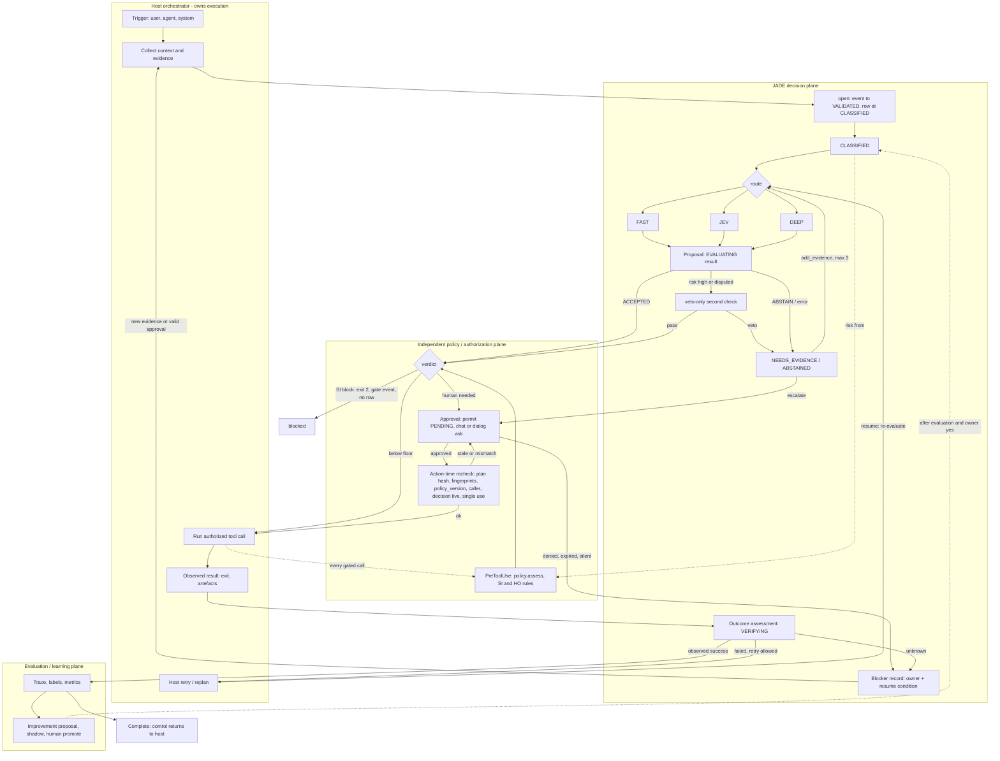

# JADE v7: decision lifecycle, ownership and contracts

Status: Planning only. Nothing here is implemented. Code cites are at worktree HEAD `8dfa86d` (parent `origin/main` `e9412f3`, EV-01, EV-02).

Scope. This doc folds the flow-architecture addendum (`ADD`, `evidence/v7-plan/addendum-flow-architecture.md`) into the v7 plan. It is a delta on [03 reference architecture](03-reference-architecture.md), repo [docs/02](../../02-contracts-and-state-machine.md) and v6 [d06](../../14-v6/06-decision-intelligence.md) / [d07](../../14-v6/07-continuous-execution.md). Tags: [fact] cites path:line or EV id; [assumption]; [hypothesis]; [unknown]; [proposal] = design, not built. Security detail of the policy plane lives in [08](08-security-operations.md); routing and fallbacks in [06](06-model-routing-strategy.md); learning in [09](09-release-and-learning.md); human questions in [10](10-decisions-and-questions.md).

## 0. Reconciliation rule (stated once, used everywhere)

Requirements: V7-A06, V7-A07, V7-A08, V7-A22, V7-R38.

| Topic | Directive component 8 ("Execution & Continuity Orchestrator") | Addendum | v7 decision |
|---|---|---|---|
| Who runs plan-act-observe-verify-recover | JADE component | Host orchestrator | **Host.** JADE owns the decision lifecycle, its bounds and its blocker records. The host (Claude Code, Cursor, another runtime) owns tool calls, operational retry, checkpoints and resume. |
| Who enforces at action time | (in component 7) | Independent policy/authorization plane | In JADE today that plane is the PreToolUse hook + `policy.assess` + permits [fact] `jade/hooks.py:375-421`, `jade/policy.py:1441`, `jade/permits.py:672`. It shares the ledger file with the decision plane but reads no model output before its own verdict [fact] `jade/hooks.py:395-421` (classify, SI block, floor) runs before `_gate` consults memory or Jev (`:585-587`). Live today (level `off`): only SI-09..SI-12 block; other SI hits and permit checks are advisory [fact] `jade/hooks.py:418`, `:427-434`; EV-10, EV-11. Full enforcement needs a human-set level (V6-16, V6-19). |
| Bounded retries, idempotency, timeouts, stop conditions | Component 8 | Section 4 | JADE **records and bounds** them on the decision row; the host **performs** the retry. No scheduler, no resident process ([ADR-v6-01](../../14-v6/04-adrs.md); v6 [d07 §1 D1](../../14-v6/07-continuous-execution.md); EV-45). |
| Decision approval vs action approval | Distinguish | Distinguish | `ACCEPTED` = quality judgment; `AUTHORIZED` + consumed permit/grant = permission fact [fact] `docs/02-contracts-and-state-machine.md:49`. Kept. |

This matches 03 row C8 "Keep + Extend (no runtime)" [fact] `03-reference-architecture.md` §2. The addendum diagram is conceptual: most gated calls never open a decision (below `permit_floor` they pass with no row [fact] `jade/hooks.py:410-415`).

## 1. Ownership matrix

Requirements: V7-A25, V7-A26, V7-A27, V7-A28, V7-A117, V7-A29.

| Plane | Owns | Existing modules [fact] | Must not | Gaps / conflicts |
|---|---|---|---|---|
| **JADE decision plane** | Framing, evidence requirements, uncertainty, risk record, route, proposal, verification trigger, trace, outcome assessment | `decide.py` (open, link, outcome, sweep), `state_machine.py` (T table, `apply`), `route.py` (`preflight`, FAST/JEV/DEEP/ESCALATE), `ask.py`, `questions.py`, `thresholds.py`, `adapter.py`, `ledger.py` (rows, events) | Run tools; schedule tasks; grant privilege | Decision-core helpers return the host type `HookResult` (`jade/memory.py:98`, `jade/askchat.py:140`): host coupling (V7-A29). `task_id` is a fresh id, not the host's task id [fact] `jade/decide.py:37`. |
| **Host orchestrator** | Task lifecycle, tool calls, retry/checkpoint/resume, delivery of the observed result | Claude Code tools, `/goal`, `/loop`, `--resume`, subagents (v6 d07 §1, docs-summary level); JADE touches it only through 5 hook events [fact] `jade/ops.py:38-39` and the `jade` CLI | Override JADE evidence; bypass the gate; promote a recommendation to authorization | Host returns exit status only, not an observed goal [fact] `jade/hooks.py:660-665` docstring. `--resume` session-id behaviour [unknown] (v6 d07 §7.3). |
| **Independent policy / authorization plane** | Permissions, approval boundaries, grant scope/expiry/revocation, SI/HO rules, action-time enforcement | `policy.py`, `shellnorm.py`, `inert.py`, `blind.py`, `samecmd.py`, `egress.py`, `interp.py`, `humanonly.py`, `permits.py`, `signing.py`, `githook.py`, enforcement point `hooks.pretool`/`_gate`, approval channels `askchat.py`, `askdialog.py`, `util.human_tty_refusal` (`jade/util.py:239`) | Treat model consensus or confidence as authority | Two delegated channels need an owner ruling against V7-A86: `proxy.step` (Jev allows inside the band at levels low/medium, `jade/proxy.py:205`) and `memory.step` class keys (one confirm covers a kind of call, EV-38). See §6 and [10](10-decisions-and-questions.md). PR 47 still has critical SI-08 regression R5-L4-1 and important CODE5-1 (EV-50): W-115 open; nothing here assumes PR 47's SI-08 is sound. |
| **Evaluation / learning plane** | Benchmarks, traces, labels, model/routing comparison, improvement proposals | `evals.py`, `improve.py` (human promotes, `jade/improve.py:381`), `ledger` `labels`/`improvements`, `ops` drift, `policies/promotion.yaml` | Change hard policy or deploy unverified changes on its own | Zero labelled rows (EV-41). Jev bench is EXPLORATORY, cannot rank models (EV-29, EV-30); keep `typesafe/jev-1.14` (Jev REPORT §0). |

Rule: an arrow from the decision plane into the policy plane may only **add** a block or a question; it never removes one (03 P1).

## 2. Lifecycle: addendum states on existing states

Requirements: V7-A30, V7-A34, V7-A35 to V7-A50 (per row), V7-A116.

Decision: keep the 22 existing status names (`schemas/decision.schema.json:40`). Addendum names become documentation aliases. Renaming would touch schema, ledger rows and 89 enforce tests (EV-60) for no behaviour gain.

**Two name collisions** [fact]: the addendum's `VERIFYING` is a pre-execution independent check; JADE's `VERIFYING` is post-execution outcome checking (`jade/state_machine.py:40-41`). The addendum's `EVALUATING` is outcome evaluation; JADE's `EVALUATING` is model judgment (`:29-34`). Code, logs and docs keep JADE's meaning; the crosswalk below is the only place both appear.

| Addendum state | JADE state(s) | Status |
|---|---|---|
| RECEIVED (V7-A35) | `open` event goes None to `VALIDATED`; the row is stored at `CLASSIFIED` (`jade/decide.py:53-60`) | partial: RECEIVED never stored |
| GATHERING_EVIDENCE (V7-A36) | Host-side before `jade decide open`; inside JADE `ABSTAINED`/`NEEDS_EVIDENCE` + `add_evidence` | partial: no state, by design |
| ASSESSING (V7-A37) | `CLASSIFIED` (`policy.assess` rule + rationale, `jade/decide.py:26,58`) | implemented |
| DECIDING (V7-A38) | `EVALUATING` (route FAST/JEV/DEEP) | implemented |
| VERIFYING? (V7-A39) | Sub-step of `EVALUATING`: veto-only second check ([06](06-model-routing-strategy.md)); result attached as an evaluation ref | missing (name collision, §2; shadow only, Jev REPORT D6) |
| AWAITING_AUTHORIZATION? (V7-A40) | `WAITING_HUMAN` + permit `PENDING` or ask `OPEN` | implemented |
| READY_FOR_EXECUTION (V7-A41) | `AUTHORIZED` | implemented |
| EXECUTING_EXTERNAL (V7-A42) | `EXECUTING` (entered only by the hook with a consumed permit/grant at risk >= high, `jade/hooks.py:566-576`) | implemented |
| EVALUATING (V7-A43) | `VERIFYING` (outcome recorded first, `jade/decide.py:86-122`) | implemented as VERIFYING (name collision) |
| COMPLETED (V7-A44) | `SUCCEEDED` (observed + success only, `jade/state_machine.py:136-137`); also `COMPENSATED`, `ROLLED_BACK` | implemented |
| NEEDS_EVIDENCE (V7-A45) | `NEEDS_EVIDENCE`, `ABSTAINED`, `NEEDS_REVISION` | implemented |
| BLOCKED (V7-A46) | `REJECTED` (policy/judgment no), `OUTCOME_UNKNOWN` (SI-07 hold), gate `safety_block` event (no decision row) | partial: no blocker record with owner + resume condition |
| DEFERRED (V7-A47) | `WAITING_DEPENDENCY` (dead: no entry edge, v6 d07 §11) | missing; see §2.3 |
| RETRYING (V7-A48) | `RETRY_SCHEDULED` (`FAILED --retry-->`, `--resume--> EVALUATING`) | partial: nothing bounds `retry` |
| FAILED (V7-A49) | `FAILED` | implemented |
| CANCELLED (V7-A50) | `CANCELLED` | implemented |

Contradiction to fix in repo docs/02 [fact]: `docs/02-contracts-and-state-machine.md:16` lists `FAILED` and `OUTCOME_UNKNOWN` as terminal; code does not (`jade/state_machine.py:12`); `FAILED` can expire (`:22`). Code is right; docs/02 needs one line.

### 2.1 Transition table

Requirements: V7-A51, V7-A52, V7-A09, V7-A10, V7-A11, V7-A13, V7-A14, V7-A15, V7-A16, V7-A17, V7-A18, V7-A19, V7-A24, V7-A71, V7-A91. Rows marked [proposal] are new guards; all others are [fact] `jade/state_machine.py:26-79` unless cited.

| From | Event | To | Guard | Owner | Side effects | Recovery |
|---|---|---|---|---|---|---|
| — | `open` | VALIDATED | schema valid | agent / hook | journal `open` | invalid: exit 6, nothing written |
| VALIDATED | `classify` | CLASSIFIED | rule matched, rationale | policy plane | risk stored; may only be raised (`decide.py:28-30`) | — |
| CLASSIFIED | `route` | EVALUATING | route in FAST/JEV/DEEP/ESCALATE/ASK | decision plane | journal route reason | — |
| EVALUATING | `fast_*` / `jev_result_*` / `deep_*` | ACCEPTED / ABSTAINED / REJECTED / NEEDS_REVISION | verdict from `thresholds.judge`; never ACCEPTED on error | decision plane | `evaluation_refs` += call id (`decide.py:82`) | — |
| EVALUATING | `jev_error` | NEEDS_EVIDENCE | provider 5 / invalid 6 | decision plane | none | fallback per [06](06-model-routing-strategy.md); never lowers a bar |
| EVALUATING | `veto` [proposal] | NEEDS_EVIDENCE or WAITING_HUMAN | second check says veto; `pass` changes nothing | decision plane | evaluation ref | human |
| ABSTAINED / NEEDS_EVIDENCE | `add_evidence` | EVALUATING | `revision_count < 3`; new `context_fingerprint` | agent | revision +1 | at 3: `escalate` |
| ABSTAINED | `escalate` | WAITING_HUMAN | risk >= medium or revisions used (`:75-76`): investigate before asking (V7-A71) | decision plane | ask/permit opened | — |
| NEEDS_REVISION | `revise` | VALIDATED | new `plan_hash`; revisions < 3 | agent | revision +1 | at 3: `escalate` |
| ACCEPTED | `authorize` | AUTHORIZED | risk < high, or ISSUED permit same plan hash (`:71-72`) | policy plane | — | — |
| ACCEPTED | `authorize_without_permit_high_risk` | WAITING_HUMAN | risk >= high | policy plane | permit PENDING | human approves or deadline |
| WAITING_HUMAN | `human_accept` / `human_reject` / `human_answer` | ACCEPTED / REJECTED / previous | human terminal; ASK route needs recorded Allow, standing answer or accepted Jev call (`:121-130`) | human (or delegated channel, §6) | answer row | — |
| AUTHORIZED | `execute` | EXECUTING | hook saw matching call; permit consumed in same tx (`hooks.py:566-576`); **action-time recheck**: plan hash, fingerprints, policy_version, caller, decision live (`permits.py:672-731`) | policy plane | permit CONSUMED; ttl 3600 | recheck fails: refusal, new permit |
| EXECUTING | `observe` | VERIFYING | outcome row stored first (`decide.py:103-115`) | host delivers, JADE records | outcome row | — |
| VERIFYING | `verified` / `failed` / `unknown` | SUCCEEDED / FAILED / OUTCOME_UNKNOWN | observed + success / success=false / unknown | decision plane | terminal revokes permits (`:156-159`) | — |
| FAILED | `compensate` / `rollback` | COMPENSATED / ROLLED_BACK | compensation ref | agent (host acts) | — | — |
| FAILED | `retry` | RETRY_SCHEDULED | today: none. [proposal] `retry_count < 2`; not irreversible unless reconciled; same `plan_hash` | agent | retry_count +1 [proposal] | at cap: `escalate` |
| RETRY_SCHEDULED / WAITING_DEPENDENCY | `resume` | EVALUATING | re-evaluates evidence and route (V7-A24) | agent / host | — | — |
| OUTCOME_UNKNOWN | `reconcile` | VERIFYING | external state read, same session (`:131-133`) | agent | — | other session: human `cancel` |
| any waiting (`EXPIRES`, `:22-23`) | `deadline` | EXPIRED | `expires_at` passed; silence is never approval (V7-A52) | runtime sweep (`decide.py:125-145`) | open permits revoked | reopen = new decision |
| EXECUTING / VERIFYING | `deadline` | OUTCOME_UNKNOWN | no outcome by deadline (SI-07) | runtime sweep | hold on same `hold_key` (`hooks.py:486-505`) | `reconcile` or human `cancel` |
| any non-terminal | `cancel` | CANCELLED | from HOLDING only a human (`:24-25`, `:88-89`) | agent / human | permits revoked | reopen = new decision |

Blocked paths outside a decision row: SI invariant hit returns exit 2 with no decision (`hooks.py:404-407`); policy load failure fails closed (`:358-372`); ledger failure at risk >= permit floor fails closed (`:418-421`).

### 2.2 Terminal and deferred states: owner and reopen condition

Requirements: V7-A68, V7-A19, V7-A46, V7-A47.

| State | Owner | Resolution / reopen condition |
|---|---|---|
| SUCCEEDED | decision plane | Final. New work = new decision. |
| COMPENSATED / ROLLED_BACK | agent (host acted) | Final. Re-attempt = new decision, new plan. |
| REJECTED | decision or policy plane | Reopen only as a new decision with a changed `plan_hash` or new evidence; the same call re-asks and hits `DENY_CAP = 3` per session (`jade/askchat.py:32,70`). |
| CANCELLED | who cancelled (journal `actor`) | New decision. |
| EXPIRED | runtime | New decision; nothing carries over (permits revoked). |
| FAILED (non-terminal) | agent | `retry` (bounded, [proposal]), `compensate`, `rollback`, or `deadline`. |
| OUTCOME_UNKNOWN (non-terminal) | agent in the same session; else human | `reconcile` with an observed read; or human `cancel`. Never auto-retry. |
| WAITING_HUMAN | human | Valid answer or approval, then **revalidation at use** (V7-A91). Deadline: EXPIRED. |
| DEFERRED (no state) | human | [proposal] Decision ends EXPIRED or CANCELLED; a work item (`waiting_human` or `blocked`, `retry_or_revisit_trigger` required, `schemas/work-item.schema.json`) carries the reopen trigger. The agent proposes the row; the human confirms (v6 DF-24; do not `work add` runtime blockers, v6 d07 §6.2). |
| Gate block (no row) | policy plane / human | Unchanged SI hit stays blocked; only a human changes policy. |

[proposal] Blocker record: when a decision enters WAITING_HUMAN, REJECTED, OUTCOME_UNKNOWN or EXPIRED, `apply` patches `blocker: {class, owner, resume_condition, since}` on the decision doc; `class` = rule id or SI/HO id (no new taxonomy, 03 §2.1 R39). SessionStart shows counts (v6 d07 §6.3). No new table.

### 2.3 `WAITING_DEPENDENCY` and `RETRY_SCHEDULED`

| Option | Trade-off |
|---|---|
| A. Keep both reserved; DEFERRED = work item (above) | No schema change; one test that nothing enters `WAITING_DEPENDENCY` (v6 d07 §11) |
| B. Add `defer` edge into `WAITING_DEPENDENCY` | Real DEFERRED state; but a decision then lives for weeks and its permits/fingerprints go stale anyway |
| C. Delete both | Breaks old ledger rows and enum [unknown: row count] |

Pick **A**: a long wait is not a decision; staleness (§3.4) would force re-evaluation on resume regardless. `RETRY_SCHEDULED` stays as RETRYING with the §3.1 bound.

## 3. Bounds, idempotency, concurrency and recovery

Requirements: V7-A53, V7-A120, V7-A96; per table below.

### 3.1 Loop bounds, no `while(true)` (V7-A54, V7-A55, V7-A56, V7-A57, V7-A58, V7-A59)

| Bound | Today [fact] | Gap | v7 [proposal] |
|---|---|---|---|
| Attempts | `MAX_REVISIONS = 3` (`state_machine.py:11`); Jev 2 per call per session-hour (`proxy.py:41`); `DENY_CAP = 3` (`askchat.py:32`); provider retries 2 (`adapter.py:28`) | `retry` unbounded | `retry_count <= 2` on the decision; then `escalate` |
| Wall-clock | provider 20 s (`adapter.py:29`); hook 6 s (`hooks.py:26`), host timeout 130 s (`ops.py:38`); ask 600 s (`askchat.py:27`); permit 1800 s (`permits.py:30`); decision 24 h (`decide.py:11`); executing 3600 s (`hooks.py:576`) | `escalation.yaml deadline_default_h` unread (v6 d07 §11) | delete the unread key |
| Tokens | state cap 32 KiB (`ask.py:19`); 8 questions per request (`routing.yaml:47`) | no token count per decision | record `input_tokens` sum per decision from `jev_calls` (read-only) |
| Money | `DAILY_BUDGET = 500` calls, **warning only** (`ask.py:177-179`) | no USD stop | `budget_stop` event at `max_usd_per_day` ([06](06-model-routing-strategy.md)): exit 5, never a lower bar |
| Tool calls | host-owned | none in JADE | count-only, after measurement (v6 d07 D4); no cap |
| Depth | none (subagents host-owned) | replan loops via `resume` | `depth` = count of `resume` + `revise` events per decision, cap 3, then `escalate` |
| Parallel provider calls | 4 in flight (`routing.yaml:48`) | — | keep |

Exhaustion of any bound goes to `escalate` or a terminal state, never to `authorize` (V7-A96).

### 3.2 Idempotency keys and resumable state (V7-A60, V7-A61)

| Operation | Key [fact] | Gap / [proposal] |
|---|---|---|
| State event | `events.idempotency_key UNIQUE` (`ledger.py:35-37`); repeat returns `applied=False` (`state_machine.py:117-119`) | keep |
| Permit use per host call | `call_id` -> `permit_consumed` key; replay window 120 s (`permits.py:39,641-669`) | keep |
| Jev question | `sha256(question_id+version+canonical(state))`, session, 3600 s (`routing.yaml:61-65`, `ledger.py:246-258`) | keep |
| Human answer | `exact_key` / `class_key` (`memory.py:42-66`) | class key: owner ruling (§6) |
| Resumable state | every status, revision count, permit and ask is a ledger row; nothing lives only in a process (`ledger.py:20-57`) | keep |
| `jade decide open` | none: a retried open makes a second decision | [proposal] optional `request_id`; same id returns the existing row |

### 3.3 Concurrency control (V7-A62)

[fact] One writer: SQLite `BEGIN IMMEDIATE` (`ledger.py:204`); nested steps are savepoints, so permit use and decision steps commit together (`hooks.py:567-576`). Permit use is a conditional `UPDATE ... WHERE state='ISSUED' AND uses=0` with `rowcount` check (`permits.py:723-724`). A decision belongs to the opening session; others may only `cancel` or answer for the human (`state_machine.py:131-133`). Ledger lock timeout fails closed above the permit floor (`hooks.py:418-421`). Gap: the CLI session fallback id differs from the hook id (v6 d07 §7.3) [fact].

### 3.4 Failure cases (V7-A63, V7-A64, V7-A65, V7-A66, V7-A67)

| Case | Today [fact] | v7 |
|---|---|---|
| Stale approval | permit refused/revoked on changed `policy_version`, precondition (`git_head`, `file_sha`), expiry, or decision not live (`permits.py:699-724`, `:803-824`) | keep; add `registry_version` and `resolved_model` to the stale set for Jev-backed grants (such a grant rests on that model and registry; a change voids it) |
| Replay | same `call_id` within 120 s answered the same, spends nothing (`permits.py:641`); later replay finds nothing | keep |
| Duplicate PostToolUse | second close finds no `EXECUTING` row and does nothing (`hooks.py:635-658`) | keep; test pin |
| Partial failure | observe + outcome + close in one tx (`decide.py:103-122`); crash test point (`state_machine.py:105`); interrupted call stays EXECUTING, then OUTCOME_UNKNOWN (`hooks.py:672-678`) | keep; SI-07 message fix for cross-session (v6 d07 §7.3, owner) |
| Changed evidence | `add_evidence` needs new fingerprint; `revise` new plan hash (`docs/02-contracts-and-state-machine.md:29,31,56`); permit precondition mismatch (`permits.py:704-716`) | [proposal] `context_freshness` past ttl at `authorize` forces `add_evidence` |
| Provider down / malformed | exit 5 / 6 -> `NEEDS_EVIDENCE`, never ACCEPTED | per [06](06-model-routing-strategy.md) |
| Stale EVALUATING call | closed after 600 s (`ledger.py:101,276-279`) | keep |

## 4. Versioned contracts (8 objects)

Requirements: V7-A106, V7-A118, V7-A78, V7-A93, V7-A94, V7-A95, V7-A31, V7-A32, V7-A33.

Common envelope [proposal]: `schema: "jade.<object>/<major>"`, `id`, `decision_id`, `correlation_id` (host task id, opaque), `created_at`, `policy_version`. Major bump = breaking. Readers fail closed on an unknown major for any object that can authorize (PolicyVerdict, ApprovalRequest); traces read unknown minors best-effort (today: `schemas.load` raises `Unreadable` and the reader fails closed, `jade/schemas.py:34-56`).

| Object | Owner (writes) | Required fields | Maps to | Status | Error semantics |
|---|---|---|---|---|---|
| DecisionRequest v1 | host/agent -> decision plane | objective, candidate_actions, constraints, assumptions, evidence_refs, session_id, correlation_id, request_id?, budgets (usd, depth enforced; tokens recorded only, §3.1) | `decide.open_decision` args; `decision.schema.json` required list | partial: no correlation_id, request_id, budgets | invalid -> exit 6, no row; duplicate request_id -> existing row |
| EvidenceBundle v1 | host supplies, decision plane validates | items[{ref, kind: observation\|source_claim\|assumption\|model_inference\|unknown, provenance, captured_at, sha256}], sufficient (deterministic), missing[], conflicts[] (pairs of item refs), budget_bytes, truncated | `evidence_refs` + `context_fingerprint` + `context_freshness` | partial | insufficient -> NEEDS_EVIDENCE; stale -> refused at preflight (`route.py:75-96`) |
| DecisionProposal v1 | decision plane | decision (verdict), alternatives, evidence refs, assumptions, calibration_group, raw_p, constraints, failure_modes, verification_required, next_action, expected_outcomes, counterarguments (agent-supplied, untrusted, never shown as advice) | decision row after EVALUATING + `jev_calls` row (p, verdict, resolved_model) | partial: no failure_modes, verification_required | verdict exits 0/3/4/5/6 (`compat.py`); agent-written fields are untrusted data, never shown as advice (DF-04) |
| PolicyVerdict v1 | policy plane only | plan_hash, hold_key, level, rule_id, blocked[], ho_ids[], reversibility, outcome: allow\|ask\|permit_required\|block, policy_version | `policy.Assessment` (`policy.py:193`), journaled as gate events | partial: in memory, not one persisted object | load or classify error -> fail closed (`hooks.py:358-372`) |
| ApprovalRequest v1 | policy plane opens; human answers | plan_hash, scope, risk_level, preconditions, channel (terminal\|chat\|dialog), expires_at, default (deny), consequence, resumes | permit row (`permit.schema.json`), `asks` row, `human_answers` | implemented (2 channels); text fields in [10](10-decisions-and-questions.md) | expiry -> EXPIRED, never approval; agent approval refused (`permits.py:520-525`) |
| ExecutionResult v1 | host | decision_id, tool call id, exit status, observed artefacts (refs), interrupted flag, observed_at | PostToolUse / PostToolUseFailure payload -> `record_outcome` (`hooks.py:660-697`) | partial: exit status only, `attribution=indirect` | missing result -> OUTCOME_UNKNOWN at deadline (SI-07) |
| OutcomeAssessment v1 | decision plane | observation_type, success, acceptance_criteria[], met[], discrepancies[], root_cause_hypotheses[], next: none\|retry\|replan\|escalate | `outcome.schema.json` (`observation_type`, `success`, `attribution_quality`) | partial: no criteria or discrepancy fields (v6 d06 §7 extension) | estimate never SUCCEEDED; `retry`/`replan` only within §3.1 |
| DecisionTrace v2 | all planes append, eval plane reads | event_id, decision_id, kind, prev/next, guard, actor, idempotency_key, policy_version, registry_version, model_id, resolved_model, cost_usd, latency_ms, lane, calibration_group, cache_hit, breaker_state, zdr (superset of [06 §10](06-model-routing-strategy.md)) | `events` table (`ledger.py:35-37`) as `jade.event/1`; this row is `jade.event/2` | partial | redacted by `redact.py`; no command text beyond it |

Mapping onto the addendum record fields (V7-A31..A33): id, version, timestamps, provenance, state, route rationale, risk, retry count exist [fact] `decision.schema.json` required list; correlation id, budgets, policy verdict object, approval reference on the decision, terminal outcome summary are missing (approval reference exists on the permit: `approval_reference`).

## 5. Final architecture diagram

Requirements: V7-A115, V7-A09 to V7-A21 (incl. V7-A20 outcome to learning, then control returns to the host), V7-A23, V7-A87, V7-A90.

Reading notes: the authorization path always passes `RC` at use, even right after approval (`permits.py:672-731`). Every host retry re-enters at `route` (V7-A24). The dotted feedback edge is never automatic (V7-A21, [09](09-release-and-learning.md)). The approval UI is whatever the host offers: chat ask and macOS dialog are probe-backed on one host only (EV-27); the terminal permit is the fallback that always exists (V7-A90).

## 6. Owner rulings this doc needs

Requirements: V7-A85, V7-A86 (detail in [08](08-security-operations.md), [10](10-decisions-and-questions.md)).

| # | Question | Recommended default | Why |
|---|---|---|---|
| OR-1 | Is `proxy.step` (Jev allows inside the band at levels low/medium) a model substituting for authorization? | Keep, recorded as **delegated authority**: the approval reference is the human-set level + band version, never the p value alone; never for HO, SI, R-13, R-18, R-22 (`proxy.py:43`). Owner choice in [10](10-decisions-and-questions.md) H-02 | The human chose the level; only the human sets it |
| OR-2 | May a memory **class** key cover other calls of a kind? | Keep exact keys; class keys off for risk >= high | V7-A86: approval for a different action is not authorization (EV-38) |
| OR-3 | Option A for DEFERRED (§2.3)? | Yes | No schema change |

## 7. Retain, refactor, remove, avoid rebuilding

Requirements: V7-A127, V7-A04.

| Verdict | Item | Reason |
|---|---|---|
| Retain | `state_machine.apply` (journaled, idempotent, session-owned) | Already the decision lifecycle the addendum asks for |
| Retain | `permits.py` single-use, plan-hash-bound, precondition, policy-version, seal, signed approval | This is the action-time recheck (V7-A87) |
| Retain | SI-07 hold, `decide.sweep` | Timeout is unknown, never success or approval |
| Retain | `hooks._gate` source order (rules, permit, memory, Jev, chat, dialog, permit request) | Deterministic first (03 P1) |
| Retain | `askchat`, `askdialog`, terminal approval | Host UI where present, terminal always |
| Retain | `improve.promote` human gate, `evals.py` | Learning never self-promotes policy |
| Retain | `adapter` deadline + bounded retry (`adapter.py:296-310`) | Fallback never lowers a bar |
| Refactor | Decision-core returns `HookResult` (`memory.py:98`, `askchat.py`) | Host-agnostic core (V7-A29); do it only when a second host exists (03 P6) |
| Refactor | `DAILY_BUDGET` warning -> USD `budget_stop` | Money bound (V7-A57) |
| Refactor | `retry` guard + `retry_count`, `depth` | V7-A54, V7-A59 |
| Refactor | Outcome schema: criteria, discrepancies (minor version) | V7-A94, V7-A95 |
| Refactor | `task_id` -> add `correlation_id` | Host link (V7-A31) |
| Refactor | docs/02 terminal list; `routing.yaml` ESCALATE "batched" text | Docs contradict code (v6 d07 §11) |
| Remove | Unread `escalation.yaml` keys | v6 d07 §11; owner yes for repo docs |
| Remove | Nothing in the state enum | Option A keeps both reserved |
| Avoid rebuilding | Workflow engine, scheduler, resident agent, Temporal/LangGraph | v6 D1, EV-45 |
| Avoid rebuilding | OPA/Cedar policy engine | EV-46 |
| Avoid rebuilding | Renaming states to addendum names | Two collisions (§2); no behaviour gain |
| Avoid rebuilding | A blocker store or `work add` for runtime blockers | v6 d07 §6.2 |
| Avoid rebuilding | jev-router anywhere in JADE | EV-21, EV-22 |
| Avoid rebuilding | Assuming a popup exists in every host | EV-27; V7-A90 |

## Open questions for the owner

1. OR-1 in §6: [H-02](10-decisions-and-questions.md). OR-2: [A-08](10-decisions-and-questions.md).
2. DEFERRED Option A (§2.3, OR-3): [A-08](10-decisions-and-questions.md).
3. Does `claude --resume` keep the hook session id [unknown] (v6 d07 §7.3)? It decides whether OUTCOME_UNKNOWN needs a human per crash: [L-05](10-decisions-and-questions.md).

## Deferred items

| Item | Owner | Priority | Trigger |
|---|---|---|---|
| Neutral `GateResult` instead of `HookResult` | agent | P3 | A second host adapter is approved |
| Tool-call counter per decision | agent | P3 | Measurement shows repeated failures (v6 d07 D4) |
| `request_id` on `jade decide open` | agent | P3 | Duplicate decisions seen in the ledger |
| `jade.event/2` | agent | P2 | [09](09-release-and-learning.md) trace work |
